# Deep JSON Color Schemes

Color schemes that give every level of JSON nesting its own color, so you can see at a
glance which level a piece of content belongs to. Six palettes are included, each in
two bracket styles (vivid and muted):

- **Monokai Classic** — the Monokai palette, with depth colors layered on top
- **Monokai Chalk** — a more pastel palette (my favorite)
- **Monokai Neon** — Monokai's accent colors at full strength
- **Monokai Neue** — inspired by Monokai Neue, with its six-color cycle
- **Jazz Solo Cup** — the teal and purple of the 1990s Jazz cup design
- **VS Code Dark** — Dark 2026, the theme VS Code ships, with depth colors on top

Each appears in *Select Color Scheme…* under the `Deep JSON - ` prefix, so the twelve
color schemes group together rather than scattering through the list.

Depth counts objects and arrays alike, so a key nested inside two arrays and an object
gets the same color as one nested four objects deep. It is aimed at the kind of document
that nests past what you can hold in your head: OpenAPI specifications, package lockfiles,
cloud configs, API captures, etc.

Use Visual Studio Code? You can get [Deep JSON for VS Code][vscode].

[vscode]: https://github.com/lanz/vscode-deep-json

## Contents

- [What it looks like](#what-it-looks-like)
- [Requirements](#requirements)
- [Installation](#installation)
- [Palette gallery](#palette-gallery)
  - [Monokai Classic](#monokai-classic)
  - [Monokai Chalk](#monokai-chalk)
  - [Monokai Neon](#monokai-neon)
  - [Monokai Neue](#monokai-neue)
  - [Jazz Solo Cup](#jazz-solo-cup)
  - [VS Code Dark](#vs-code-dark)
- [Use a color scheme for JSON only](#use-a-color-scheme-for-json-only)
- [Bracket coloring](#bracket-coloring)
- [Indentation guides](#indentation-guides)
- [Markdown highlighting](#markdown-highlighting)
- [Customize the colors](#customize-the-colors)
- [Why I built this](#why-i-built-this)
- [How depth coloring works](#how-depth-coloring-works)
- [Development and extending the schemes](#development-and-extending-the-schemes)
  - [Change the palette](#change-the-palette)
  - [Change the structure](#change-the-structure)
  - [Check it still works after a Sublime update](#check-it-still-works-after-a-sublime-update)
- [Credits](#credits)
- [License](#license)

## What it looks like

A vulnerability-findings OpenAPI spec in **Deep JSON - Monokai Chalk**. The response schema
reaches fourteen levels, so the palette has cycled by the bottom of the file.

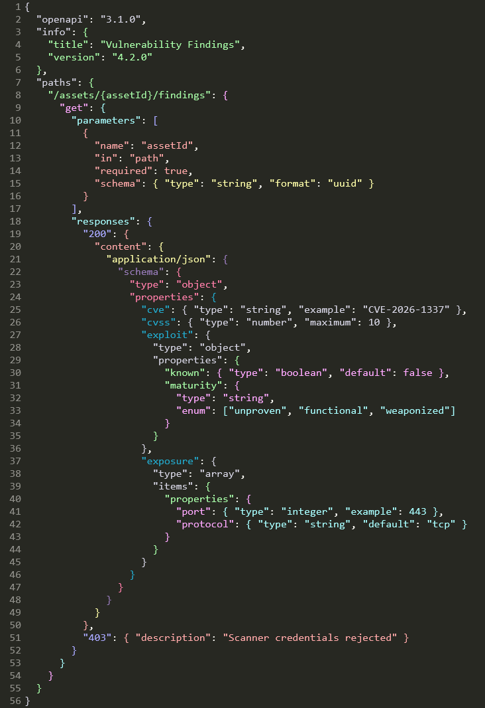

The `samples/` folder holds the JSON used for every shot on this page, if you want to
compare them yourself.

## Requirements

**Sublime Text 4.** The depth coloring relies on scope names that ST4's JSON syntax
produces; on ST3 and earlier you would get the base palette with no depth coloring.
Verified on builds 4200 and 4215.

## Installation

**Package Control** — *Preferences → Package Control → Install Package*, then **Deep JSON
Color Schemes**. Pick a scheme under *Preferences → Select Color Scheme…*

**Manually** — copy the `.sublime-color-scheme` files into a folder under `Packages`
(*Preferences → Browse Packages…*), then pick one under *Select Color Scheme…*

These are complete color schemes rather than JSON-only ones. To use one for JSON while keeping
your own scheme everywhere else, see *Use a color scheme for JSON only* below.

## Palette gallery

Each palette below is shown against the same three sample files, so you can compare
them directly.

### Monokai Classic

Built on **Monokai**, the palette by Wimer Hazenberg that Sublime Text still ships as one
of its five default color schemes. The base palette stays intact; the depth colors are
layered on top, so everything outside JSON still looks like the Monokai you already know.

This is the original version of the idea: take the palette everyone recognizes and use it
to give JSON's nesting some visual structure.

| Objects | Arrays | Mixed |
|---|---|---|
| 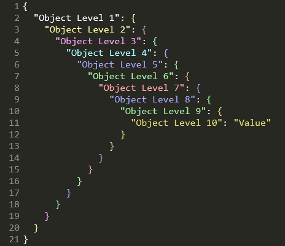 | 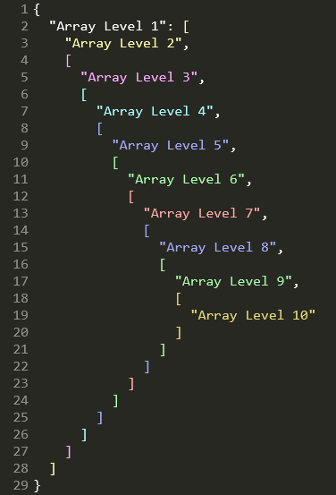 | 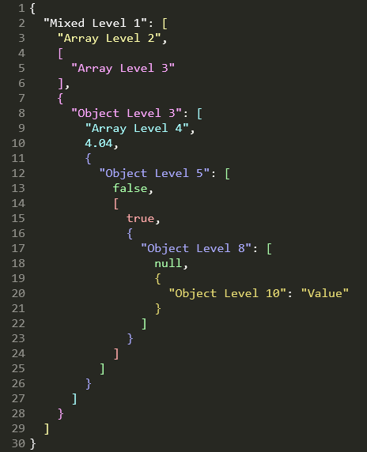 |

### Monokai Chalk

This is the one I use. It's also my favorite.

Monokai Classic came first, and it carried a minor flaw: four of its ten levels are
near-duplicates of each other. You don't really notice it in a small file. You notice it
five or six levels down, which is exactly where you need the colors to be doing the
most work.

Chalk uses a soft, pastel feel near the surface, but fixes the repetition. Every level
gets a color that is distinct enough to recognize, and the deep end gets a purple, a pink,
and a teal of its own. Open a spec that nests ten levels deep and the shape starts to
resolve at a glance.

The name comes from the palette's pastel, almost chalky colors.

| Objects | Arrays | Mixed |
|---|---|---|
| 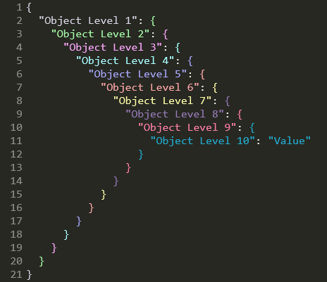 | 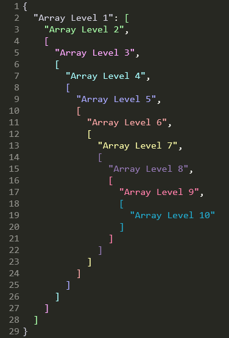 | 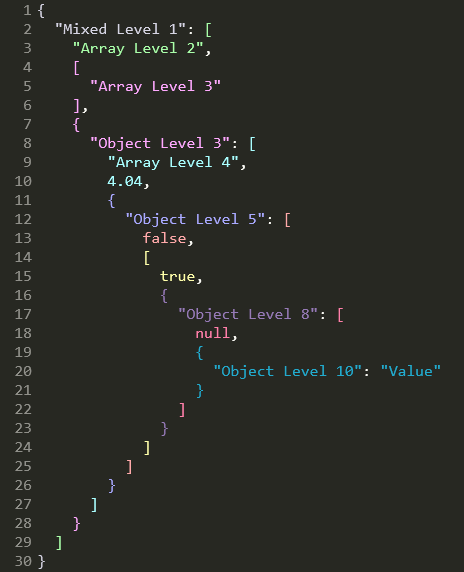 |

### Monokai Neon

The same Monokai base, with the depth ramp turned all the way up.

Neon uses Monokai's accent colors at full strength. Levels 1 to 7 are the foreground and the
colors Monokai gives to keywords, parameters, strings, functions, types, and constants.
Monokai only has seven, so levels 8 to 10 are extensions chosen to stay as distinct as
possible from everything above them.

Every pair of levels is at least dE 20 apart in CIELAB, so even ten levels down the colors
are designed to remain easy to tell apart.

This one is for when you don't want your nesting to whisper. You want it to make itself
known.

| Objects | Arrays | Mixed |
|---|---|---|
| 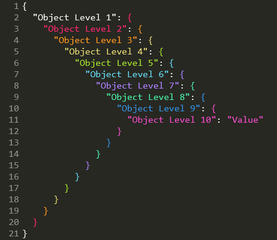 | 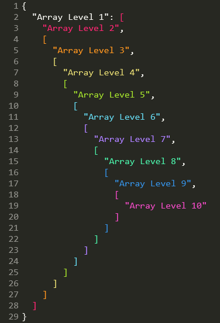 | 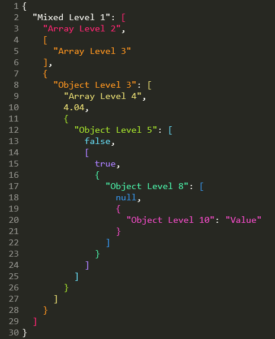 |

### Monokai Neue

A JSON version of **Monokai Neue** by Josh Kaplan, with its darker background and its own
set of accents. The depth ramp uses six of Neue's accent colors on a six-level cycle, kept
exactly as he wrote it. The base is the same: all 152 syntax rules, so everything outside
JSON still looks like the Neue you may already have installed.

The original Neue highlighting colored object keys, and only object keys. This version
extends that to string values, array elements, numbers, and booleans, colors arrays
as well as objects, and carries the cycle past level 10.

| Objects | Arrays | Mixed |
|---|---|---|
| 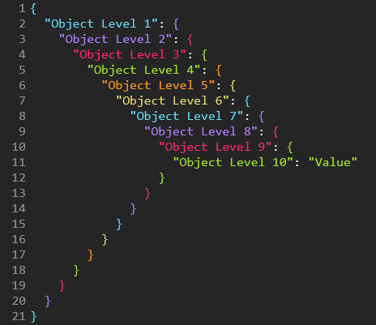 | 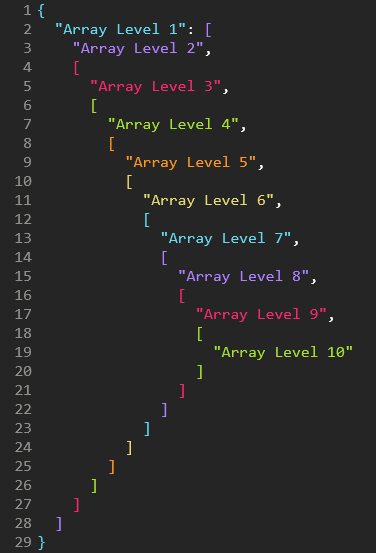 | 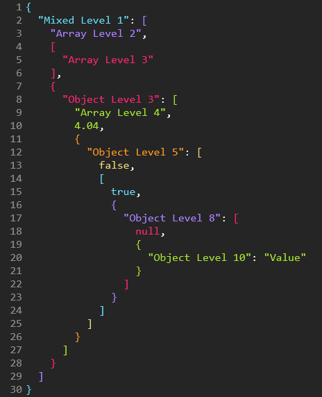 |

### Jazz Solo Cup

If you were alive in the 1990s and ever drank something from a disposable cup, there is a
decent chance you've seen this design.

**Jazz** was Sweetheart Cup Company's wonderfully loud teal-and-purple pattern: a jagged
teal brush stroke with a purple zig-zag floating above it. It was on cups, plates, bowls,
and basically anywhere a perfectly respectable beverage or serving of nachos could be
accompanied by an unnecessary amount of neon.


And then, somehow, the pattern escaped.

It became one of those oddly specific pieces of 1990s visual culture that people started
recognizing everywhere decades later. There are sightings blogs. Tattoos. Custom sneakers.
A minor-league baseball jersey. The internet, having apparently decided that disposable
tableware deserved a nostalgia revival, did the rest.

So naturally, I made it a JSON color scheme. The palette borrows the same teal-and-purple
pairing.

If Monokai Classic is for people who want their JSON to look like a terminal, Jazz Solo Cup
is for people who want their JSON to look like it just came back from a 1994 birthday
party.

| Objects | Arrays | Mixed |
|---|---|---|
| 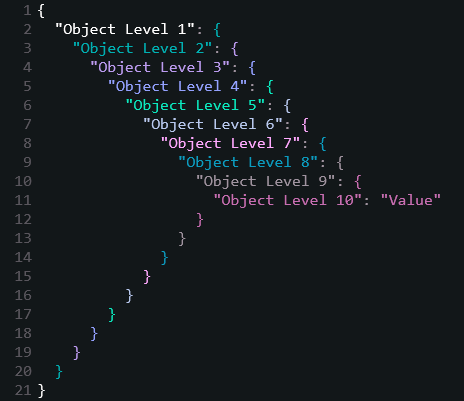 | 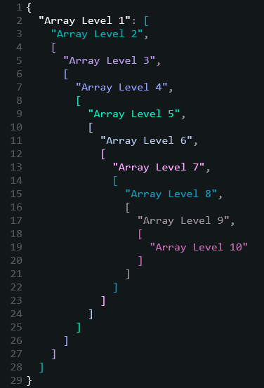 | 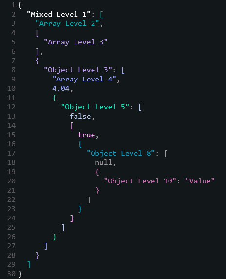 |

### VS Code Dark

The one for people who split their time between editors.

**Dark 2026** is the theme Visual Studio Code ships with, and this is that theme in
Sublime Text, with depth colors layered on top. Its syntax rules are TextMate rules, the same
thing Sublime's `rules` are, so all 118 of them carry over directly; the editor colors it
shares with Sublime carry over too. Open anything that isn't JSON and it looks like VS
Code.

The depth ramp is Dark 2026's own syntax colors, in the order its rules use them, which is
why the file still reads as the same theme. Levels 1 to 6 are the foreground and the colors
it gives to constants, entity names, tags, keywords, and functions. Dark 2026 has only six
that are mutually distinct, so levels 7 to 10 reach back into the classic VS Code palette
that it inherits through `dark_modern`: the teal, the tan, the sage, and its debug purple.
Every pair of levels is at least dE 22 apart in CIELAB.

The [VS Code port][vscode] ships the same scheme, reading the same theme, so a file looks
the same in both editors.

| Objects | Arrays | Mixed |
|---|---|---|
| 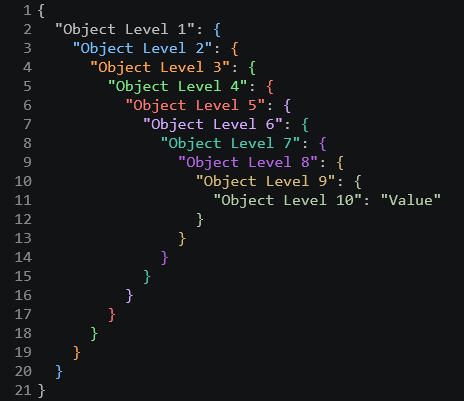 | 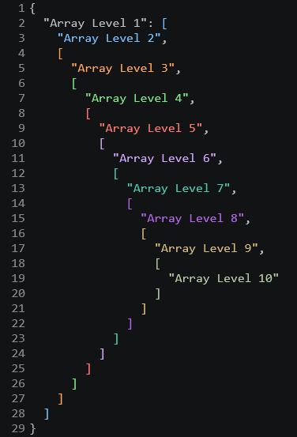 | 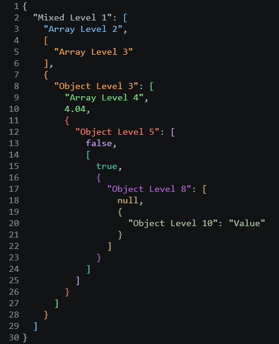 |

## Use a color scheme for JSON only

These are complete color schemes, so selecting one changes every file you open. To keep your
usual scheme and use one of these for JSON alone, set it as a syntax-specific setting rather
than selecting it.

Open a JSON file, then *Preferences → Settings – Syntax Specific*. That opens
`Packages/User/JSON.sublime-settings`, which applies to JSON files and nothing else:

```json
{
    "color_scheme": "Deep JSON - Monokai Chalk.sublime-color-scheme",
}
```

Your global scheme under *Preferences → Settings* is left alone, and every other syntax keeps
using it. Sublime consults the syntax-specific file after your preferences, so this wins for
JSON views.

Three things worth knowing:

- **The value is the filename alone.** Sublime's docs are explicit for this format: "Color
  schemes based on the `.sublime-color-scheme` format are specified by filename only, not a
  package-based file path."
- **A scheme includes its background.** JSON files will use this scheme's background while the
  rest of your files keep yours. That is what a per-syntax scheme is; there is no way to take
  the depth colors without the rest of the scheme.
- **`"color_scheme": "auto"` is overridden.** If you follow the operating system appearance,
  naming a scheme here replaces that for JSON views. To keep following the system for JSON too,
  set `light_color_scheme` and `dark_color_scheme` in this file instead, since those are what
  `auto` reads.

To see what a view actually resolved to, run this in the console (Ctrl+`):

```python
view.settings().get('color_scheme')
```

## Bracket coloring

Braces and brackets follow depth too, each taking the color of the container it opens or
closes, so a matched pair always agrees. Every palette ships in two styles:

- **Vivid**, the plain scheme name — delimiters take exactly the content color at that depth
- **Muted**, the `(Muted Brackets)` one — the same hues desaturated, so delimiters read as
  structure instead of competing with the content they wrap

| Vivid | Muted |
|---|---|
|  | 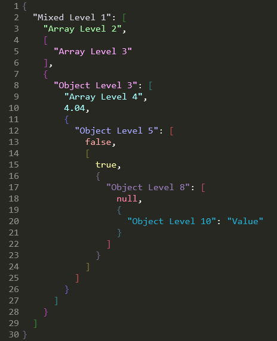 |

Sublime Text has no bracket colorizer of its own, so the depth rules are the only thing
coloring delimiters. (The `match_brackets` settings draw a matching indicator, which is
unrelated and still works.)

Delimiter colors are their own variables, `json_bracket1` through `json_bracket10`, so you
can recolor braces and brackets without touching the content colors. See *Customize the colors*
below; the same override mechanism applies.

## Indentation guides

Each scheme sets its own three guide colors, derived from its palette so they belong to the
scheme without competing with the content:

| Global | Drawn for |
|---|---|
| `guide` | every indentation group in the file |
| `stack_guide` | the enclosing groups between your caret and the top |
| `active_guide` | the group your caret is actually in |

Four schemes declare theirs rather than deriving them, because the colors belong to the
designs: Monokai Classic takes Hazenberg's `#9D550FB0`, Monokai Neue the blue of its own
first level, Jazz Solo Cup its `#00B1B3`, and VS Code Dark the two Dark 2026 already sets,
with the stack placed between them. Monokai Chalk and Monokai Neon derive all three from
their palettes.

Unlike the depth colors these cannot vary by nesting level: Sublime draws guides as chrome
rather than as tokens, so there is nothing for a per-level rule to attach to. If the active
guide is hard to pick out of the stack, `"indent_guide_options": ["draw_normal",
"draw_active_single"]` narrows the active color to the innermost guide alone.

## Markdown highlighting

These are complete color schemes rather than JSON-only ones, so they color every language
you open; JSON is just the part that gets depth coloring. The color schemes also add a full
rule set for markdown in all six palettes: headings, emphasis, inline and fenced code, quotes,
links, lists, tables, and the punctuation around them.

Monokai Neue and VS Code Dark inherit theirs from the themes they are built on. Monokai
Classic, Chalk, Neon and Jazz Solo Cup use the mapping below, drawn from each palette's own
accents.

| Element | Monokai Classic, Chalk, Neon | Jazz Solo Cup |
|---|---|---|
| Prose | the default foreground | teal |
| Headings | orange, bold | violet, bold |
| Bold and italic | pink | pink |
| Inline code | yellow | mint |
| Block quotes | cyan, italic | lavender, italic |
| Link URLs | cyan, underlined | lavender, underlined |
| Link text and titles | green | violet |
| List bullets | pink | violet |
| References and escapes | purple | white |
| Hashes, ticks, pipes, quote arrows | comment grey | foreground grey |

Every structural mark takes the palette's comment color, so the prose stays the thing you
read and the punctuation holding it up recedes. A fenced block that names a language keeps
that language's own highlighting: only the ticks and the language label are colored.

Jazz is the one that colors prose rather than leaving it the default foreground. It is a
wide teal stroke with a thin purple zig-zag above it, so the teal is the base and carries
the prose, and the purple family carries the structure on top of it.

The four hand-written palettes had almost none of this before. The `.tmTheme` files they
came from carried three markup rules between them, all of them for diffs, so a Markdown
file rendered as one flat color.

## Customize the colors

Every depth color is a variable at the top of each file, so recoloring a level is a
one-line change:

```json
"json_level1": "#FFFFFF",
"json_level2": "#FFFFAA",
```

You don't have to edit the package to do it. Sublime merges color schemes that share a
filename, with `Packages/User` winning, so you can override just the colors you care about
and leave everything else alone. Create `Packages/User/Deep JSON - Monokai Classic.sublime-color-scheme`:

```json
{
	"variables":
	{
		"json_level2": "#7FDBCA",
		"json_level3": "#C792EA",
	},
}
```

Your overrides survive package updates. The same trick works for any variable in the file,
not just the depth colors.

Levels 1–10 use the palette, then it cycles: level 11 reuses `json_level1`, up to level 20.
Anything deeper than 20 keeps the level 20 color.

## Why I built this

I've spent way too much time drafting and editing OpenAPI specs. The kind where you open a
response schema, follow `properties` into another object, find an `allOf`, fall into a few
more levels of nesting, and eventually realize you're spending as much effort keeping
track of the structure as you are reading the content. By the time you reach something as
ordinary as a field's `type`, you are typically eleven levels deep.

In a single flat color, reading a spec like that means counting braces and matching
indentation to work out which object you are actually looking at. I got tired of counting
braces. Giving each level of nesting its own color turns that into something you can just
see: content that shares a color shares a level.

When the structure gets that deep, indentation only gets you so far. I wanted something
that made the hierarchy visible without having to mentally trace it.

So I wrote **Monokai JSON++** for Sublime Text 2, an extended version of Monokai JSON+ by
ColibriApps, then added **Jazz Solo Cup** for Sublime Text 3. Both stopped working on Sublime
Text 4, whose rewritten JSON syntax replaced the `meta.structure.dictionary.json` scopes the
old rules targeted. Every JSON file went back to being one flat color. This project adds
support for Sublime Text 4. The palettes are the originals, recovered from the old `.tmTheme`
files by recomputing each rule's depth from its selector.

That depth is also why this version runs to 20 levels and cycles rather than stopping at 10.
The old cap was a consequence of how the schemes had to be built, not a decision, and
it ran out of colors one level short of where an OpenAPI spec puts a field's type.

## How depth coloring works

Sublime Text 4's JSON syntax stacks one scope per level of nesting:
`meta.mapping.value.json` inside objects, `meta.sequence.json` inside arrays. A bare
`meta` selector atom matches either, so a run of N `meta` atoms means "nested at least N
deep".

That alone leaves every shallower rule also matching a deep token: at a level-10 key, all
ten rules match. Sublime does appear to paint the most deeply nested of them, and it does
so regardless of the order they appear in the file. But that behavior is not documented,
and a scheme that depends on it is one Sublime release away from the breakage that started
all this.

So each rule is instead made mutually exclusive with the `-` operator: level N means "at
least N deep" AND NOT "at least N+1 deep". Here are the object key selectors for levels 1
and 2:

```json
"scope": "source.json meta.mapping.key string - meta meta.mapping.key",
"scope": "source.json meta meta.mapping.key string - meta meta meta.mapping.key",
```

Exactly one rule can match any given token, so ranking never gets a vote at all. Object
keys, string values and array elements, numbers, `true`/`false`/`null`, and the braces and
brackets themselves are each covered at 20 levels.

Delimiters work the same way, on `punctuation.section.mapping` and
`punctuation.section.sequence`. A delimiter carries its own container's meta scope, so a
matched pair sits at the same depth and takes the same color. That is worth stating because
the syntax pushes the object context *after* matching the opening brace, which suggests the
opener would be a level shallower. It is not: `meta_scope` covers the text that pushes and
pops a context.

There is no way to write "either a mapping value or a sequence" inside a descendant chain:
`(a|b)` in that position doesn't do what it looks like. That is why the older ST2/ST3
versions of these schemes had to enumerate every one of the 2ᴺ nesting paths, and why they
were about 1 MB and 1,563 rules each. These are about 49 KB and 165 rules, or 61 KB and
272 for Monokai Neue and 54 KB and 238 for VS Code Dark, whose bases carry fuller sets of
syntax rules.

## Development and extending the schemes

**You don't need any of this to change colors.** Recoloring a level is a one-line variable
edit, see [Customize the colors](#customize-the-colors) above. Everything below is for changing how the
schemes are built.

The generator isn't installed with the package, to keep the download small. Clone the repo
to get it. Generating and checking the schemes is plain Python 3 with no dependencies;
only the optional screenshot check needs Pillow.

### Change the palette

All six palettes sit at the top of `dev/build.py`, as `MONOKAI_LEVELS`,
`MONOKAI_CHALK_LEVELS`, `MONOKAI_NEON_LEVELS`, `MONOKAI_NEUE_LEVELS`, `JAZZ_LEVELS` and
`VSCODE_DARK_LEVELS`. Edit them and regenerate:

```
cd dev
python build.py
```

For a one-off recolor, prefer the `Packages/User` override described above, it survives
package updates. Editing the palette here is for building your own scheme to keep or
share.

Two schemes build on someone else's theme rather than on a palette written out in
`build.py`. Their bases live in `dev/palettes/` as JSON, extracted by
`dev/extract_neue_base.py` and `dev/extract_vscode_dark_base.py`; each reads the original
from a local install and translates its globals and syntax rules into Sublime's format.
Rerun one to pick up a change upstream. The extracted files are checked in, so building
needs neither editor installed.

### Change the structure

`dev/depth_selectors.py` holds the two numbers that shape everything:

```python
PALETTE_SIZE = 10   # colors before the palette repeats
MAX_LEVEL = 20      # deepest level given its own rule
```

Raise `MAX_LEVEL` if you routinely nest deeper than 20, or change `PALETTE_SIZE` to match
a longer palette. This is also where you would add a new token kind: a selector builder in
`BUILDERS`, an entry in `COLOR_VARIABLE` naming the palette variable it reads, and a label
in `KIND_LABEL` in `dev/build.py`. The `mapping` and `sequence` builders that color braces
and brackets were added exactly that way.

Don't edit the `.sublime-color-scheme` files directly; `build.py` overwrites them.

### Check it still works after a Sublime update

The depth coloring depends on scope names that ST4's JSON syntax produces. A change there
is exactly what broke the ST2/ST3 versions of these schemes, so if an update ever leaves
your JSON looking flat or miscolored:

```
cd dev
python verify.py
```

If it **fails**, it names the level and token kind that broke. If it **passes**, the
selectors are still sound and Sublime's JSON syntax has moved underneath them. Run *Tools
→ Developer → Show Scope Name* on a deeply nested key and compare what you get against
`dev/fixtures/st4-scope-stacks.json`.

It checks that exactly one rule matches any given token, that it is the rule for the right
level, and that no rule bleeds across token kinds: 11,360 synthetic cases covering every
object/array nesting permutation to depth 8 plus representative shapes beyond, the 28 real
scope stacks in `dev/fixtures/st4-scope-stacks.json` captured from ST4 build 4200, and 116
real delimiter stacks in `dev/fixtures/bracket-scopes.json` captured from build 4215 by
`dev/probe_bracket_scopes.py`. The matcher it uses was
cross-checked against Sublime's own `sublime.score_selector()` over 1,920 comparisons with
no disagreements.

There is also `dev/verify_screenshots.py`, which reads each palette out of the generated
scheme file and checks the screenshots pixel by pixel, so an image that drifts out of date
gets caught. It is the only thing here with a dependency: `pip install pillow`.

## Credits

Inspired by [Monokai JSON+](https://github.com/ColibriApps/MonokaiJsonPlus/) by ColibriApps.

Monokai Classic is derived from the Monokai palette by Wimer Hazenberg.

Monokai Neue is derived from [Monokai Neue](https://github.com/josh-kaplan/sublime-monokai-neue) by Josh Kaplan.

Jazz Solo Cup borrows the colors of the *Jazz* cup design, created at Sweetheart Cup
Company and introduced in 1992.

VS Code Dark is derived from Dark 2026, from the MIT-licensed
[microsoft/vscode](https://github.com/microsoft/vscode) repository, Copyright (c) Microsoft
Corporation.

## License

Copyright (C) 2026 [Lance Duvall](https://github.com/lanz).

Licensed under the [GNU Affero General Public License v3.0](LICENSE) or later.
